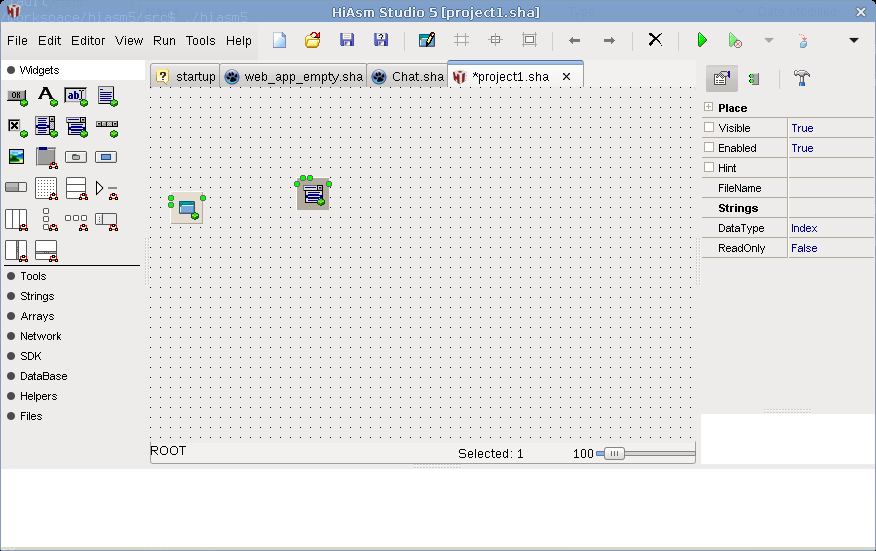

<h1 align="center">HiAsm Studio</h1>

<!--
<p align="center">
  <a href="README.md">English</a> |
  <a href="README.zh.md">简体中文</a> |
  <a href="README.ja.md">日本語</a> |
  <a href="README.ru.md">Русский</a>
</p>
-->

[](https://github.com/ili4yov-ika/hiasm/actions/workflows/ci.yml)
[](https://github.com/ili4yov-ika/hiasm/actions/workflows/ci-linux.yml)
[](https://github.com/ili4yov-ika/hiasm/actions/workflows/ci-macos.yml)


# 

HiAsm — среда визуального программирования на C++ и Qt6.9.3. Проект хранится в текстовой схеме `.sha`. В редакторе можно добавлять элементы из палитры, перемещать их и открывать вложенные схемы. Двойной щелчок по значению свойства в инспекторе позволяет его изменить. Доступны также правка исходного текста схемы и отмена изменений.

## Быстрый старт в Windows

Установите Qt 6.9.3 для LLVM-MinGW x64, соответствующий LLVM-MinGW, CMake и Ninja из Qt SDK, а также Python 3 для создания каталогов SQLite. Откройте обычный терминал Windows в корне проекта.

```bat
tools\build_windows.bat release
```

После сборки скрипт запускает `build\Windows_LLVM-MinGW-x64-Release\hiasm.exe`. Запустить его можно и напрямую. Для сборки без открытия окна используйте `tools\build_windows.bat release build-only`. Менеджер проектов открывается в IDE по Ctrl+N. Компиляция схем встроена в `hiasm.exe`. В комплект входят RTCG и библиотека виджетов Core. Для сборки, отладки и запуска этих программ MSYS2, GTK3 и GTK4 не требуются.

В окне «Создание проекта» сверху выбирают пакет, снизу — его шаблон. Для пакетов HiAsm 4 IDE читает список установок из `packs/_hiasm4/paths.ini`. Чтобы указать другой список, задайте `HIASM4_ROOTS` с путями через точку с запятой. Например, при выборе «HiAsm 4: cnet → Console» откроется новая схема с палитрой CNET. Шаблон в установке HiAsm 4 сохраняется в исходном виде. Для компиляции внешних пакетов нужен 32-битный мост к генераторам HiAsm 4. В Qt-версии подключены открытие и редактирование таких схем.

**F7** собирает текущую схему, **F9** собирает и запускает программу, **Shift+F9** останавливает её. Для схемы без имени IDE берёт содержимое вкладки и использует отдельную временную папку для сборки и запуска. Первое сохранение выполняется через «Сохранить» или «Сохранить как». После сохранения результаты сборки появляются в `build/qt-native/` рядом с файлом схемы. Примеры для проверки — `packs/cpp/example/hello.sha` и `packs/cpp/new/QtForm.sha`.

Команда **Вид → Редактор формы** и кнопка с карандашом открывают конструктор. В Delphi-примере `Elements/delphi/Example/Forms/Notepad.sha` панель инструментов закреплена сверху, а поле заметок занимает свободную область. Потяните за нижний маркер панели, чтобы изменить её высоту. Выберите `ChildForm` в меню **⋯** рядом с путём внизу, чтобы открыть окно About.

В конструктор элемент также можно перетащить из палитры. Щелчок по размещённому элементу открывает его свойства. Двойной щелчок по значению позволяет его изменить. Перетаскивание перемещает элемент, а маркеры выделения меняют размер с учётом выравнивания. Delete удаляет выбранный элемент, Ctrl+Z отменяет правку.

В панели «Элементы» группы и подгруппы раскрываются щелчком по заголовку. Выберите элемент одним щелчком и перенесите указатель на схему или форму. Полуперекрестье со значком показывает место вставки. Щёлкните для размещения или нажмите Esc, чтобы отменить его. Двойной щелчок по значку добавляет элемент сразу.

Элементы `WebBrowser` и `Flash` пакета C++ используют Chromium. В Windows схемы собираются обычным комплектом Qt для LLVM-MinGW и используют Microsoft Edge WebView2 Runtime. В Linux и macOS нужен Qt WebEngine. `Flash` запускает Ruffle из ресурсов собранной программы и воспроизводит локальные SWF без подключения к интернету. [Настройка комплекта и Ruffle](MARKDOWN/BUILD_WINDOWS.md#схемы-с-webbrowser-и-flash)

Чтобы создать связь, протяните её мышью между двумя совместимыми зелёными точками. Чтобы отсоединить конец связи, перетащите занятую точку на свободное место или выберите «Удалить связь» в меню этой точки. Перетащите на свободную совместимую точку, чтобы переподключить конец. Ctrl+Z восстанавливает прежнюю связь вместе с её маршрутом.

Масштаб меняется ползунком под схемой или сочетанием Ctrl + колесо мыши. Цвета окна, схемы и редактора форм меняются через **Вид → Тема**. Выбор сохраняется между запусками.

Панели доступны в меню **Вид** и на вкладках по краям редактора. «Каталог проектов» открывает примеры встроенных пакетов и установленных пакетов HiAsm 4. Изменённые примеры из установки HiAsm 4 сохраняются через «Сохранить как». «Репозиторий проекта» показывает схемы из текущего или выбранного каталога и запускает действия установленного Git или SVN. В «Настройке сборки» можно выбрать Debug или Release для C++-схемы и указать компилятор C++. «Ошибки» показывает диагностику сборки. Двойной щелчок по ошибке синтаксиса открывает строку схемы.

В «Терминале» выберите доступную оболочку, введите команду и нажмите Enter. Сеанс запускается в каталоге активной схемы и сохраняет переменные и переходы между каталогами между командами. Вывод программы, запущенной по F9, доступен на вкладке «Вывод программы».

Вкладки «Схема», «Исходник» и «Форма» используют общий путь внизу окна. Наведите указатель на `ROOT` или на имя одного из родительских уровней и щёлкните по подчёркнутому названию. Меню **⋯** открывает дочерние уровни. Во вкладке «Исходник» переход устанавливает курсор в начале выбранного уровня. При переключении вкладок уровень сохраняется.

Чтобы открыть содержимое `ChildPanel`, дважды щёлкните по контейнеру на схеме или форме. Размер внутренней рамки меняется перетаскиванием правой или нижней границы. В числовой рамке `EditMulti` можно протянуть связь от контакта элемента к свободному месту на совместимой стороне рамки. Например, протяните `onClick` кнопки к правой границе. После возврата по пути к родительской схеме у контейнера появится соответствующий выход `onEvent1`. Создание контакта и связи отменяется одним Ctrl+Z. Для C++-форм сборка Qt поддерживает ChildPanel с панелью Panel и поддерживаемыми виджетами, включая связи событий и данных через рамку.

Схемы прежних версий в Windows-1251 открываются с сохранением кодировки и перевода строк. Если при редактировании добавлен символ вне Windows-1251, редактор записывает файл в UTF-8 с BOM.

Из командной строки тот же исполняемый файл собирает схему без открытия окна:

```bat
build\Windows_LLVM-MinGW-x64-Release\hiasm.exe --build packs\cpp\example\hello.sha hello.exe
build\Windows_LLVM-MinGW-x64-Release\hiasm.exe --generate packs\cpp\new\QtForm.sha form.cpp
```

## Редакторы и установка

- **Qt Creator** открывает корневой `CMakeLists.txt` или `HiAsm.pro`. Выберите комплект Qt 6.9 и цель запуска `hiasm`.
- **VS Code** использует задачу `HiAsm: build Qt Debug` и профиль `HiAsm: Debug Qt` с GDB из Qt SDK.
- **Zed** использует задачу `HiAsm: build Qt Debug` и профиль `HiAsm Qt (Debug)` с CodeLLDB.
- **Установщик Windows** собирается командой `tools\build_windows.bat installer`. Для неё нужен NSIS 3. Результат — `build\HiAsm_Setup_Qt.exe`. Установщик включает Qt, компилятор C++ и пакеты.

Инструкции по путям SDK, переносимой установке и тестам приведены в [руководстве по сборке](MARKDOWN/BUILD_WINDOWS.md). Возможности пакета описаны в [документации C++](docs/cpp.md), состояние переноса — в [чеклисте](MARKDOWN/CHECKLIST.md).

## Linux и macOS

Нужны CMake, Ninja, компилятор C++, Python 3 и комплект Qt 6.9 или новее с Widgets, Sql (с драйвером SQLite) и LinguistTools. При установке Qt в отдельный каталог передайте его в `CMAKE_PREFIX_PATH`.

```sh
cmake -S . -B build/qt -G Ninja -DCMAKE_BUILD_TYPE=Release
cmake --build build/qt
ctest --test-dir build/qt --output-on-failure
./build/qt/hiasm
```

Для схем с `WebBrowser` и `Flash` добавьте Qt WebEngine к тому же комплекту Qt. Для `Flash` подготовьте локальный Ruffle Self-Hosted.

```sh
python3 tools/fetch_ruffle_web.py build/deps/ruffle
export HIASM_RUFFLE_DIR="$PWD/build/deps/ruffle"
```

В GitHub Actions Linux и macOS собирают IDE, запускают CTest и проверяют навигацию Chromium и воспроизведение тестового SWF. Проверка запускает собранную схему с Xvfb на Linux и с Cocoa на macOS.
